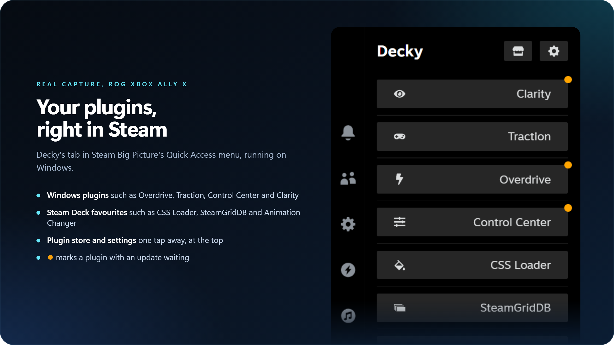

  

  
  
  
  

  <b>The Decky plugin loader, ported to Windows.</b> 
  Plugins in Steam Big Picture's Quick Access menu on ROG Ally, Legion Go, MSI Claw and other Windows handhelds.

  <a href="#install">Install</a> &nbsp;·&nbsp;
  <a href="#how-it-works">How it works</a> &nbsp;·&nbsp;
  <a href="#plugins-for-windows">Plugins</a> &nbsp;·&nbsp;
  <a href="#good-to-know">Good to know</a> &nbsp;·&nbsp;
  <a href="#technical-details">Technical details</a> &nbsp;·&nbsp;
  <a href="#credits">Credits</a>

 

<table>
  <tr>
    <td width="25%" valign="top"><b>Decky on Windows</b> The Quick Access tab, the plugin store and plugin settings, as on the Steam Deck.</td>
    <td width="25%" valign="top"><b>Runs Steam Deck plugins</b> A Windows layer stands in for the Linux tools many plugins call, so more of them work unchanged.</td>
    <td width="25%" valign="top"><b>Safe mode</b> Start Decky without plugins to recover from one that breaks Steam's interface.</td>
    <td width="25%" valign="top"><b>Windows plugin store</b> Windows-only plugins (performance, controls, upscaling) listed next to the official store.</td>
  </tr>
</table>

  

> [!IMPORTANT]
> **This is an unofficial port.** It is not made or supported by the [Decky Loader](https://github.com/SteamDeckHomebrew/decky-loader) team. Please report Windows problems [here](https://github.com/musika08/decky-loader-windows/issues), not to them. On a Steam Deck, use the [official Decky Loader](https://github.com/SteamDeckHomebrew/decky-loader).

## Install

The easy way is the free setup app, **Decky Plugin for Windows**. It installs Decky Loader for Windows, keeps it updated, and repairs it after Windows updates:

  

1. Download it from [musika08/decky-plugin-for-windows](https://github.com/musika08/decky-plugin-for-windows/releases/latest), extract the zip and run `DeckyPluginForWindows.exe`.
2. Choose **Decky Loader** (and any other parts you want) and approve the Windows administrator prompt.
3. Open Steam in Big Picture mode. The Decky tab appears in the Quick Access menu.

To build and install it yourself from this repository instead, see [Technical details](#technical-details).

## How it works

  

## Plugins for Windows

Most Steam Deck plugins are written for SteamOS; many work here, some need porting. These plugins are made for Windows handhelds, in the [Windows plugin store](https://musika08.github.io/decky-windows-store/) that Decky Loader for Windows shows next to the official one:

| Plugin | |
|---|---|
| [Overdrive](https://github.com/musika08/overdrive) | Performance, power limits, FPS limit and fans for the ROG Ally family |
| [Traction](https://github.com/musika08/traction) | Controller mode, grip vibration and touchscreen for the ROG Ally |
| [Control Center](https://github.com/musika08/decky-control-center) | Windows quick settings |
| [Clarity](https://github.com/musika08/clarity) | Per-game OptiScaler with AMD FSR 4 Lite and frame generation |

## Good to know

> [!CAUTION]
> Decky runs with administrator rights, and, like Decky on Linux, it accepts commands from programs on your own PC (`127.0.0.1`). Software already running on your PC could use it to install plugins that run with administrator rights. Only install plugins you trust.

- Decky keeps running when Steam restarts or Big Picture closes. If Decky itself restarts while Steam shows it, it restarts Steam's interface so the Decky tab comes back.
- Plugins that need Linux-only features (Proton, flatpak, SteamOS tools) don't apply on Windows.
- Tested on a ROG Xbox Ally X with Windows 11.

## Technical details

<b>Manual install, updating, uninstall, portable mode and plugin compatibility</b>

 

Decky Loader also runs on Windows, next to the Steam client. It is not installed through the Steam Deck installer.

**Requirements**

- A Windows account with administrator rights. Installed mode registers an elevated task, so it cannot be set up from a standard account.
- Steam's remote debugging enabled. Decky connects to Steam's debugger at `http://localhost:8080`, so it must be reachable there. See [the Decky wiki](https://wiki.deckbrew.xyz) for how to enable it.

**Install**

1. Build the installer folder from a checkout of this repository: `powershell -ExecutionPolicy Bypass -File tools\update-decky.ps1 -Rebuild -NoInstall` (it builds the frontend, runs the backend tests and calls `tools\build_win_runtime.py`). This makes `build\installer\DeckyLoader` next to the checkout, with a `python` folder (a private copy of the Python runtime the backend venv was made from, which must be the python.org build signed by the Python Software Foundation; the build checks the signature) and an `app` folder (Decky's source and its dependencies). Installed mode does not use a PyInstaller exe; the single-file `.exe` builds are for portable mode and cannot be installed.
1. If you were running a portable copy of Decky, close it first. Both use port 1337, so the installed copy cannot start while it runs.
1. From any terminal, in the installer folder, run `python\python.exe -I app\main.py --install` (`tools\update-decky.ps1` without `-NoInstall` does this for you). Windows will ask for administrator approval if needed. This copies the `python` and `app` folders to `%ProgramFiles%\Decky Loader` and registers a scheduled task named `Decky Loader`, which runs `%ProgramFiles%\Decky Loader\python\pythonw.exe -I "%ProgramFiles%\Decky Loader\app\main.py"` at every logon, without a window, and starts it right away. The runtime there only loads code from its own `Lib`, `DLLs` and `..\app` folders (a `python313._pth` file), never from `PYTHONPATH` or the current directory, and `-I` makes it ignore every other `PYTHON*` environment variable too (Decky refuses to start on that runtime without `-I`). The elevated install runs in a console window of its own that closes when it finishes; if it fails, the reason is in `%ProgramData%\decky\logs\install.log` (or a `%TEMP%\decky-install-*.log` file when that folder is not there yet), and `tools\update-decky.ps1` prints it. It also creates the empty file `.cef-enable-remote-debugging` in your Steam folder if it is missing, which turns on Steam's debugger that Decky connects to (restart Steam once for it to take effect). Uninstalling leaves that file in place. You can delete the extracted folder afterwards.
1. Open Steam in Big Picture mode. The Decky tab appears in the Quick Access menu.
1. Install plugins from Decky's built-in store.

**Restarting**

Restarting Steam or closing Big Picture does not stop Decky. If Decky itself restarts while Steam still shows it (for example after an update), it restarts Steam's webhelper, so the Steam interface reloads briefly. If Decky was stopped, for example with the shutdown option in its settings, start it again without logging out by running `schtasks /Run /TN "Decky Loader"`.

**Where things live**

The program is in `%ProgramFiles%\Decky Loader` (`python` is its Python runtime, `app` is Decky itself). Plugins and Decky's settings are in `%ProgramData%\decky` (`plugins` and `settings`), which only administrators can change.

**Updating**

Decky's built-in updater is not available in installed mode; its Updates page says so instead of offering an update. To update, run `tools\update-decky.ps1`, or build a new installer folder and run `python\python.exe -I app\main.py --install` from it again. This stops the running Decky, replaces `%ProgramFiles%\Decky Loader`, and starts the new version. Plugins and settings are kept.

**Developer options**

The Developer settings' remote debugging toggle forwards port 8081 on all network interfaces to Steam's debugger, as on Linux, so anyone on your network can reach it without authentication. It is off by default. Decky does not change firewall rules, so Windows may block or ask about incoming connections. The crash screen's "enable SSH" option starts the OpenSSH Server Windows service (`sshd`) if it is already installed (Settings > System > Optional features); Decky never installs it.

**Upgrading from an older Windows build**

Installs made by older builds kept the program in `%ProgramData%\decky\services` and started it through `wscript.exe`, or installed `PluginLoader.exe` with its `_internal` folder in `%ProgramFiles%\Decky Loader`. Running `--install` from a new installer folder replaces both: it stops them, removes `%ProgramData%\decky\services`, `%ProgramData%\decky\tmp` and the old `PluginLoader.exe` and `_internal`, and keeps your plugins and settings.

Plugins in `%USERPROFILE%\homebrew\plugins` from portable mode are not moved to the install. Reinstall them from Decky's store. Plugin settings and data in `%USERPROFILE%\homebrew` are kept. Decky's own settings (plugin order, update branch and similar) live in `%ProgramData%\decky\settings` in installed mode, so they do not carry over from portable mode.

**Uninstall**

Run the installed copy: `"%ProgramFiles%\Decky Loader\python\python.exe" -I "%ProgramFiles%\Decky Loader\app\main.py" --uninstall`, and approve the Windows administrator prompt. This removes the scheduled task and `%ProgramFiles%\Decky Loader` (and any `%ProgramData%\decky\services` or `tmp` left by an older build). Files that are still in use are deleted at the next restart. Plugins and settings in `%ProgramData%\decky` are left in place.

**Portable mode**

Portable mode is the single-file exe: `PluginLoader-win.exe` (x86_64) or `PluginLoader-win-arm64.exe` (ARM). The `-noconsole` variants (`PluginLoader-win-noconsole.exe`, `PluginLoader-win-arm64-noconsole.exe`) do the same without a console window. Run it without any arguments. Plugins that need the `root` flag then run without administrator rights, so some of them will not work fully, and Decky's built-in updater can update it in place. Installed mode is recommended.

**Security notes**

In installed mode, Decky runs with administrator rights. Like Decky on Linux, which runs as root, it accepts commands from local programs on `127.0.0.1`. This means software already running on your PC can use Decky to install plugins that run with administrator rights. If you do not want that, use portable mode instead.

**Known limits**

In installed mode, plugins without the `root` flag run with standard user rights and cannot write inside their own plugin folder (`%ProgramData%\decky\plugins`). They should keep their files in their settings and data folders under `%USERPROFILE%\homebrew`.

Plugins that depend on Linux-specific features (Proton, flatpak, SteamOS-only tools) do not apply on Windows.

**Plugin compatibility on Windows**

Plugins are written for SteamOS. To let more of them load unchanged, Decky adds a few stand-ins inside each plugin's process:

- `fcntl`: `flock` and `lockf` work as whole-file locks. Shared locks (`LOCK_SH`) are exclusive on Windows, and `lockf` locks taken through two different file descriptors conflict even inside one process (on Linux they belong to the process). `fcntl.fcntl` flag calls do nothing, and `ioctl` fails.
- `pwd` and `grp`: describe the current Windows user, with the user profile as home directory. `os.getuid()` and similar return 0 for `root` plugins running with administrator rights and 1000 otherwise. `os.chown` does nothing.
- `/tmp` and `/home/deck`: for plugins without administrator rights, Decky creates `C:\tmp` and links `C:\home\deck` and `C:\home\<your user name>` to your user profile, if those names are free. Existing files and folders are never replaced. Plugins with administrator rights do not get these, and should not use `/tmp` at all, because `C:\tmp` may be owned by a standard user. Use `DECKY_PLUGIN_RUNTIME_DIR` instead.
- Steam paths: for plugins without administrator rights, `~/.steam/root`, `~/.steam/steam` and `~/.local/share/Steam` lead to your Steam install folder, as on SteamOS. Missing `.steam`, `.local` and `.local\share` folders are created as normal folders. A plain folder already in one of those three places is renamed to `<name>.decky-old`; links and files are left alone.
- `chmod` is on the plugin's `PATH` and does nothing. It is a `.cmd` script, found by `shell=True` commands and `shutil.which`.
- Program names in list-form calls: Windows only adds `.exe` to a program name, so `subprocess.run(["chmod", ...])` or `asyncio.create_subprocess_exec("chmod", ...)` would not find `chmod.cmd`. When a plain name (no folder, no extension) is not found that way, Decky looks it up on the call's `PATH`, in `PATHEXT` order. With `env=`, the `PATH` in that environment is searched, as `execvpe` does on Linux. Only folders with a drive letter or a `\\server\share` prefix count; Linux-style entries such as `/usr/bin` are skipped. It accepts `.exe` and `.com` files from any absolute `PATH` folder, but `.cmd` and `.bat` scripts only from Decky's own stand-in folder, because `cmd.exe` would read their arguments as commands. For the same reason a stand-in script is not run when an argument contains `" % ! ^ & | < > ( )` or a control character; the call then fails as it would without Decky. If nothing is found, a few programs that install outside `PATH` are looked for where their installer puts them: `tailscale` in `Program Files\Tailscale` (the real Program Files folder, never `%ProgramFiles%`). Calls with `executable=` are never changed.
- Linux tools: list-form calls of `ps`, `kill`, `pgrep`, `pkill`, `killall`, `pidof`, `timedatectl` and `date` (also as `/usr/bin/...`, `/bin/...` and similar) run Decky's own versions of them, with the plugin's own rights. `ping` does too when its options are Linux ones (`-c`, `-W`, `-q`, `-D`, `-O`); other `ping` calls keep Windows' `ping.exe`. Only the options plugins use are there; anything else fails like bad usage does on Linux. A call with a Windows-style switch such as `date /t` is left to Windows.
  - `ps`, `kill` and the others only see processes in your Windows session that belong to your account. `SIGSTOP` (and `TSTP`, `TTIN`, `TTOU`) suspends every thread of a process and `SIGCONT` resumes it; `ps` shows a suspended process as `T`. `SIGINT`, `SIGQUIT`, `SIGTERM` and `SIGKILL` end the process at once, since Windows has no graceful `SIGTERM`. Signals without a Windows equivalent (`HUP`, `USR1`, `USR2`...) fail, and process groups (negative ids) are not supported. Decky itself (the loader and other plugins' processes) and the Steam client (including its overlay and error reporter) are never suspended or ended: Decky's interface runs inside Steam, and the `steam` command plugins use to restart it does not exist on Windows. Control characters in names and command lines show as `?`, and `killall -w` gives up after 30 seconds.
  - `ping` answers in the format of Linux's `ping` (iputils), so plugins can read it. IPv4 only, and each lost packet costs its full `-W` timeout (4 seconds if not given). Intervals (`-i`) below 0.2 seconds are refused for plugins without the `root` flag, as Linux refuses them for normal users.
  - `timedatectl show` and `timedatectl status` report the time zone (as a name such as `Europe/Berlin`), whether Windows sets the time automatically (`NTP`), and, as `NTPSynchronized`, whether it does and the Windows Time service is running. `date` supports `+FORMAT` with the GNU format codes, `-u`, `-R` and `-I`; time zone abbreviations print as offsets such as `+08`, because Windows has none. `timedatectl set-time` and `set-ntp` only work for plugins with the `root` flag, which Decky runs as administrator; `set-ntp` turns Settings' "Set time automatically" on or off. For other plugins they fail with "Access denied", and Decky never asks for administrator rights. `date` never changes the clock.
- `sudo`, `su` and `runuser`: in front of a list-form call, Decky drops them when they would not change the user: `sudo -u <your user name>` or `sudo -u deck` in a plugin without the `root` flag, and plain `sudo` or `sudo -u root` in a plugin with it. `su <user> -c '...'` only works for a simple command (no pipes, redirections or variables). Anything else, such as another user, or root in a plugin without administrator rights, fails with an explanation instead of switching users or asking for administrator rights. A `root` plugin's `sudo -u <your user name>` also fails, because Decky can't drop administrator rights for a single command.
- Python scripts: in plugins without the `root` flag, a list-form call whose program is the full path of a Python script (`.py`, or a file without extension whose `#!` line names python) runs on Decky's own Python, as Linux would run it through its `#!` line. A file without extension is skipped when a `.exe` or `.com` of the same name sits next to it, since Windows runs that one. Plugins with the `root` flag never get this: a standard user could plant such a file in a folder they can write to.
- Commands with `shell=True` (also `os.popen` and `asyncio.create_subprocess_shell`): a simple command for one of the Linux tools or `sudo` above (no pipes, redirections, variables or wildcards; for example `"date '+%Y-%m-%d'"`) runs as a list-form call instead of through `cmd.exe`. Every other command reaches `cmd.exe` exactly as written, so POSIX single quotes do not group words there. `doas` and `pkexec` are always refused, and so are user switches nested more than three deep.

Not covered: `xdg-open` (a `.cmd` stand-in would run its arguments through `cmd.exe`; use `os.startfile` instead), `/proc`, `/sys`, `/dev`, `systemctl`, `nmcli`, `ip`, D-Bus, flatpak, `pty`/`termios`, Linux signals sent with `os.kill`, Linux programs bundled with a plugin, and shell scripts (`.sh`). Plugins that need these must be ported.

## Support

If Decky on your Windows handheld makes your games better, you can support this port:

  

And please support the original Decky project, which made all of this possible: [opencollective.com/steamdeckhomebrew](https://opencollective.com/steamdeckhomebrew).

## Credits

- [Decky Loader](https://github.com/SteamDeckHomebrew/decky-loader) by the Steam Deck Homebrew team and its contributors. This repository is their work plus the Windows port on the `windows-platform-fixes` branch; the original README for the Steam Deck is on [their page](https://github.com/SteamDeckHomebrew/decky-loader#readme).
- Windows port by Musika.

Licensed under the GNU General Public License, version 2: see [`LICENSE`](LICENSE). Unofficial; not affiliated with Valve or the Decky Loader team.
