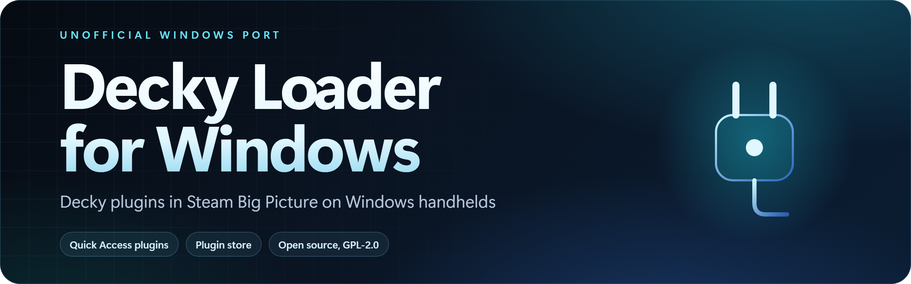
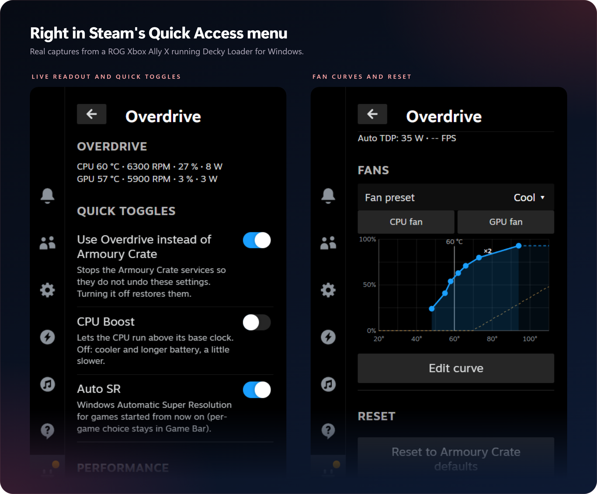
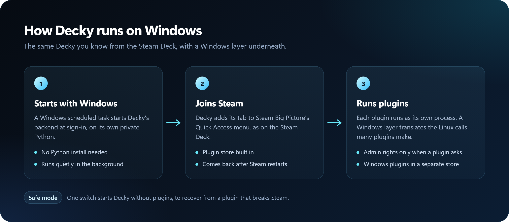

<p align="center">
  
</p>

<p align="center">
  <a href="https://github.com/musika08/overdrive/releases/latest"></a>
  <a href="https://github.com/musika08/overdrive/releases"></a>
  <a href="LICENSE"></a>
  <a href="https://ko-fi.com/musika"></a>
</p>

<p align="center">
  <b>Your ROG Ally's performance controls, right in Steam's Quick Access menu.</b><br>
  Overdrive sets the performance mode, power limits, FPS limit and fan curves on the ROG Ally family, trims watts automatically with Auto TDP, and can stand in for Armoury Crate while you play.
</p>

<p align="center">
  <a href="#install">Install</a> &nbsp;·&nbsp;
  <a href="#use">Use</a> &nbsp;·&nbsp;
  <a href="#how-it-works">How it works</a> &nbsp;·&nbsp;
  <a href="#tested">Tested</a> &nbsp;·&nbsp;
  <a href="#faq">FAQ</a> &nbsp;·&nbsp;
  <a href="#support">Support</a>
</p>

<br>

<table>
  <tr>
    <td width="25%" valign="top"><b>Modes and watts</b><br><sub>Silent (13 W), Balanced (17 W), Turbo (35 W), or Manual with your own sustained, slow and fast boost limits from 5 to 50 W.</sub></td>
    <td width="25%" valign="top"><b>Auto TDP</b><br><sub>Watches the frame rate and holds your FPS limit at the lowest watts. With the limit off, it drops only the watts that add no frames.</sub></td>
    <td width="25%" valign="top"><b>Fan curves</b><br><sub>Armoury default, Recommended, Quiet, Cool or your own 8-point curve, for the CPU and GPU fan. Never below a safe minimum.</sub></td>
    <td width="25%" valign="top"><b>Instead of Armoury Crate</b><br><sub>One switch stops Armoury Crate's services so they don't undo your settings, and puts them back exactly as they were.</sub></td>
  </tr>
</table>

<p align="center">
  
</p>

> [!CAUTION]
> **Overdrive changes hardware settings and Windows services.** Manual power limits go up to 50 W, more than the Turbo mode's 35 W: more heat and less battery. "Use Overdrive instead of Armoury Crate" stops Armoury Crate's services (and the ASUS services that come with it) and changes how they start, until you turn it off again; Overdrive records how each one was set first and restores exactly that. It is unofficial and not made or supported by ASUS.

> [!NOTE]
> **ROG Ally family only.** On any other PC the panel says "Overdrive supports the ROG Ally family only" and changes nothing. Since 0.2.0 the controller mode, grip vibration and touchscreen switch live in [Traction](https://github.com/musika08/traction), and the battery charge limit is in the Control Center plugin.

## Install

1. Install Decky Loader for Windows with the free [Decky Plugin for Windows](https://github.com/musika08/decky-plugin-for-windows) setup app on your ROG Ally.
2. In Decky, open the **Store**, find **Overdrive** and install it.

Or install the zip from the [latest release](https://github.com/musika08/overdrive/releases/latest) by hand.

On another Decky build, add the store list yourself: Decky settings, Store, **Custom**, then enter `https://musika08.github.io/decky-windows-store/plugins`. That address is for Decky to read; opening it in a browser only shows the raw plugin list.

## Use

1. Open the Quick Access menu, then **Decky**, then **Overdrive**.
2. If Armoury Crate is installed, turn on **Use Overdrive instead of Armoury Crate** so it does not override your choices. The switch can take a few minutes.
3. Under **Performance**, pick **Silent**, **Balanced**, **Turbo** or **Manual** (Manual shows three sliders for the power limits).
4. Pick an **FPS limit** and, if you like, turn on **Auto TDP**.
5. Under **Fans**, choose a preset, or tap **Edit curve** to drag the points (or move them with the D-pad) and apply your own.

The top of the panel shows CPU and GPU temperature, fan speed, usage and power, updated every 2 seconds. **Reset to Armoury Crate defaults** (press twice) goes back to Balanced, Manual limits of 30 W, the default fan curves and no FPS limit. Turning the Armoury Crate switch off restores its services.

## How it works

<p align="center">
  
</p>

<details>
<summary><b>Under the hood</b></summary>
<br>

The hardware work is done by `bin\asus-helper.exe`, a small helper that Overdrive's Python backend runs as one long-lived process and talks to in JSON lines. Its device code is a port of [G-Helper](https://github.com/seerge/g-helper) at commit [`c0901745`](https://github.com/seerge/g-helper/tree/c09017453d9ed0c52261b67a48d02bd55232e6ac), rewritten for C# 5 / .NET Framework 4.8 and built with the compiler that ships with Windows.

| Control | How |
|---|---|
| Device check | BIOS `SystemProductName` contains `RC7` (read from `HKLM\HARDWARE\DESCRIPTION\System\BIOS`) |
| Mode, power limits, fan curves | ASUS ACPI calls through `\\.\ATKACPI`, in G-Helper's order |
| FPS limit | AMD ADL frame rate target control, as G-Helper does |
| Auto TDP | AMD ADL frame metrics every 300 ms; the three power limits are set together, between 6 W and the mode's watts (the Sustained slider in Manual) |
| Live readout | CPU temperature and both fan speeds from ASUS ACPI; GPU temperature, usage and power from AMD ADL (GPU temperature falls back to ACPI) |
| CPU Boost, Battery power mode | Windows power settings (PowrProf) |
| Auto SR | The `DXGIEffects` entry of Windows' DirectX user settings |

With an FPS limit, Auto TDP adds 2 W as soon as the game falls behind and takes 1 W away after a steady run, only when the GPU draws less than the current limit. With the limit off it measures the game's frame rate at full watts, then trims down to the lowest watts that keep it, and measures again every minute.

The Armoury Crate switch first records each service's start type and whether it was running, then stops them. That record is shared with Traction at `C:\ProgramData\decky\armoury\state.json` (saved atomically, with a backup copy), and a lock lets only one plugin switch at a time. Turning the switch off restores exactly what was recorded; a switch cut short, for example by a Decky restart, is put right at the next start.

Settings are stored in Decky's settings folder and put back on start, after sleep and when the charger is plugged in or out.

</details>

## Tested

| Device | System | Result |
|---|---|---|
| ROG Xbox Ally X | Windows 11 | Works; the panel captures above are from this device |

## FAQ

<details>
<summary><b>Do I still need Armoury Crate?</b></summary>
<br>
No, but you can keep it. While it runs, Armoury Crate can change the mode back, so Overdrive offers to stop its services. Turn the switch off at any time and they come back exactly as they were.
</details>

<details>
<summary><b>What does Auto TDP do?</b></summary>
<br>
It reads the game's frame rate from the AMD driver and lowers the power limit as long as the game keeps its pace, so the Ally runs cooler and longer on battery. It never goes above the watts of the mode you picked. It needs the AMD driver's frame-rate reading; if your driver doesn't offer it, the switch stays off and the panel says so.
</details>

<details>
<summary><b>Can a fan curve be too low?</b></summary>
<br>
No. Every curve, yours included, is kept at or above G-Helper's safe minimum for each temperature, shown as the dashed line on the chart. A curve that goes down or breaks the minimum can't be applied.
</details>

<details>
<summary><b>Where did the controller and vibration settings go?</b></summary>
<br>
Since 0.2.0 they are in <a href="https://github.com/musika08/traction">Traction</a> (controller, screen and touch). A settings file from 0.1.0 still loads; its controller and vibration entries are ignored.
</details>

## Support

If Overdrive makes your Ally run the way you want, you can support its development:

<p>
  <a href="https://ko-fi.com/musika"></a>
</p>

## Credits

- [G-Helper](https://github.com/seerge/g-helper) by seerge and contributors (GPL-3.0): the device code Overdrive ports.
- [Decky Loader](https://github.com/SteamDeckHomebrew/decky-loader) by the Steam Deck Homebrew team.

Overdrive is unofficial and not affiliated with ASUS or AMD. Licensed GPL-3.0-only; see [`LICENSE`](LICENSE) and [`THIRD-PARTY-NOTICES.md`](THIRD-PARTY-NOTICES.md).

<details>
<summary><b>For developers: build and test</b></summary>
<br>

```
npm install
npm run typecheck
npm run build
powershell -NoProfile -ExecutionPolicy Bypass -File helper\build.ps1
```

`npm run build` writes `dist/index.js`; `helper\build.ps1` compiles the helper to `bin\asus-helper.exe` (in-box .NET Framework compiler, no download). `tools\render-assets.ps1` re-renders the README images from `.github\assets\src`.

A plugin folder for Decky contains `plugin.json`, `package.json`, `main.py`, `py_modules\`, `dist\`, `bin\asus-helper.exe`, `LICENSE` and `THIRD-PARTY-NOTICES.md`.

Tests (none touch hardware, services or the registry):

```
powershell -NoProfile -ExecutionPolicy Bypass -File helper\build.ps1 -Tests
python -m pytest -q tests
node --test tests/frontend/*.test.mjs
```

</details>
